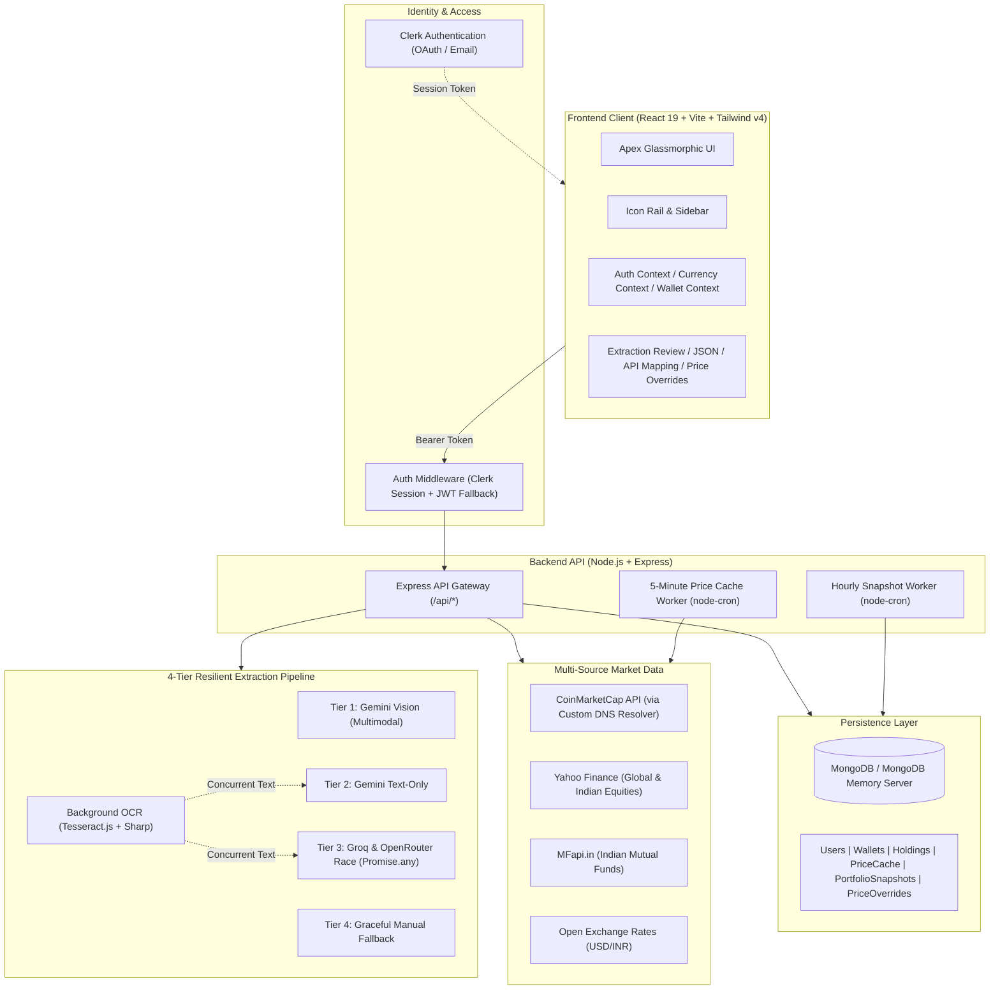
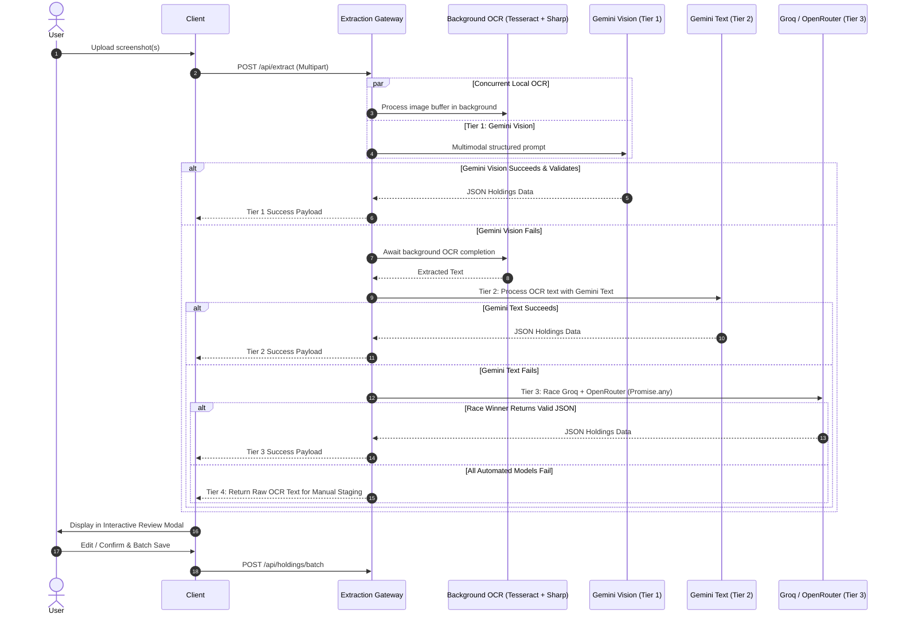

# 🚀 AI-Powered Multi-Asset Portfolio Tracker

[](#technology-stack)
[](#authentication-flow)
[](#resilient-4-tier-ai-extraction-pipeline)
[](#market-pricing--valuation-engine)

An enterprise-grade, high-density financial portfolio management platform engineered to track **Cryptocurrency**, **Global & Indian Equities**, **Indian Mutual Funds**, and **Cash Reserves** in real time. 

The platform features an advanced **4-Tier AI/OCR Extraction Pipeline** that reads brokerage and wallet screenshots (Zerodha, Groww, Binance, Phantom, Hyperliquid, etc.), parses holdings with multi-model fallback, reconciles price discrepancies, and presents an interactive staging review before persisting to the database.

---

## 📑 Table of Contents

- [Key Features](#-key-features)
- [System Architecture](#-system-architecture)
- [Resilient 4-Tier AI Extraction Pipeline](#-resilient-4-tier-ai-extraction-pipeline)
- [Market Pricing & Valuation Engine](#-market-pricing--valuation-engine)
- [Technology Stack](#-technology-stack)
- [Project Directory Structure](#-project-directory-structure)
- [Getting Started & Local Development](#-getting-started--local-development)
  - [Prerequisites](#prerequisites)
  - [Backend Setup](#backend-setup)
  - [Frontend Setup](#frontend-setup)
  - [Running the Application](#running-the-application)
- [Environment Variables Reference](#-environment-variables-reference)
- [API Reference](#-api-reference)
- [Deployment Guide](#-deployment-guide)

---

## 🌟 Key Features

### 1. 🤖 4-Tier Resilient AI Screenshot Extraction
- **Tier 1 (Multimodal Vision)**: Google Gemini Vision (`@google/generative-ai` with `gemini-3.5-flash`) extracts assets, quantities, buy prices, and current valuations directly from screenshots.
- **Tier 2 (Gemini Text-Only)**: Automatically feeds raw OCR into Gemini if visual inference fails.
- **Tier 3 (Third-Party Race)**: Races Groq (`openai/gpt-oss-120b`) and OpenRouter simultaneously via `Promise.any` on OCR text.
- **Tier 4 (Manual Fallback)**: Preserves extracted OCR text so user input is never lost.
- **Concurrent OCR Pre-computation**: Runs local `tesseract.js` + `sharp` image processing concurrently with Tier 1 to eliminate latency cascades.
- **Price Mismatch Resolution**: Detects and fixes discrepancies between extracted unit price, quantity, and total invested value.
- **Mandatory Review-Before-Save**: Interactive staging review modal allows editing values and verifying mappings before database commit.
- **Prompt-Engineering JSON Modal**: Users can copy an optimized extraction prompt to ChatGPT, Claude, or Gemini, and paste the raw JSON back for automated schema repair and quote linking.

### 2. 📊 Multi-Asset Portfolio Management
- **Crypto Assets**: Real-time tracking of major coins and Hyperliquid ecosystem tokens (`BTC`, `ETH`, `SOL`, `HYPE`, `WHYPE`, etc.).
- **Global & Indian Stocks**: Live price updates from Yahoo Finance for US tickers (`AAPL`, `NVDA`) and Indian NSE/BSE tickers (`CANBK.NS`, `RELIANCE.NS`).
- **Indian Mutual Funds**: Scheme code integration (`mfapi.in`) with NAV lookup, automated scheme name matching (Direct vs. Regular, Growth vs. IDCW), and nearest-NAV selection heuristics.
- **Cash & Stablecoins**: Track liquidity across `USD`, `INR`, `USDT`, and `USDC`.
- **Interactive Symbol Mapping (`ApiMappingModal`)**: Search and bind assets to exact Yahoo tickers or AMFI scheme codes with live quote preview.
- **Manual Price Overrides (`PriceEditModal`)**: Set custom valuations for unlisted or illiquid assets with single-click reset to live market prices.

### 3. 💱 Multi-Currency Valuation & Real-Time Forex
- Switch instantly between **USD ($)**, **INR (₹)**, **BTC (₿)**, and **HYPE (H)** across all metrics, charts, and tables.
- Live USD-to-INR conversion rate updated via open exchange rate APIs.
- Indian numbering system support (automatic formatting into **Lakhs [L]** and **Crores [Cr]**).

### 4. 💼 Hierarchical Wallet Architecture
- Group assets across multiple wallets or accounts (e.g. *Cold Storage*, *Binance Account*, *Zerodha Equity*, *Emergency Cash*).
- Wallet aggregation pipelines with automatic allocation percentage calculation.
- Cascading deletion: Safely remove a wallet and all nested holdings with typed confirmation protection (`DELETE`).

### 5. 📈 Quantitative Analytics Suite
- **Interactive Net Worth Chart**: Multi-timeframe portfolio performance charts (`24h`, `7d`, `30d`, `90d`, `1y`, `All`) powered by ECharts and Recharts.
- **Automated Hourly Snapshots**: `node-cron` background worker captures portfolio net worth hourly for longitudinal analysis.
- **Risk & Concentration Panel**: Herfindahl-Hirschman concentration index, Top 1 / Top 3 / Top 5 asset weights, and diversification scoring.
- **Drawdown Tracking**: Quantifies current drawdown and peak-to-trough decline.
- **PnL Contribution Matrix**: Highlights top gainers, top losers, and attribution breakdown.
- **Asset Allocation Visualizer**: Donut breakdown by asset class and wallet share.

### 6. 🎨 Apex Modern Glassmorphic UI/UX
- Responsive desktop layout with collapsible **Icon Rail** and expandable wallet drawer.
- Mobile bottom navigation bar and touch-friendly drawers.
- **Optimistic UI with Automatic Rollback**: Instant table cell updates on edit, rolling back cleanly if the network request fails.

---

## 🏗 System Architecture



---

## ⚡ Resilient 4-Tier AI Extraction Pipeline

When a user uploads a portfolio screenshot, the server runs the following pipeline:



---

## 💰 Market Pricing & Valuation Engine

The pricing service (`server/src/services/priceService.js`) maintains a unified valuation pipeline:

1. **User Price Overrides**: If the user has manually pinned a custom price for a symbol via `PriceOverride`, that valuation takes top priority.
2. **DNS Bypass for Crypto**: Certain ISPs block cryptocurrency API endpoints (e.g., `pro-api.coinmarketcap.com`). The server uses a custom Node `dns.Resolver` pointed to `8.8.8.8` and `1.1.1.1` to ensure reliable quotes.
3. **Equities via Yahoo Finance**: Real-time batch quote fetching for US stocks (`AAPL`, `MSFT`) and Indian exchange tickers with `.NS` / `.BO` suffixes.
4. **Mutual Funds via AMFI**: Real-time NAV queries to `https://api.mfapi.in/mf/<schemeCode>`. If only a fund name is provided, fuzzy matching and nearest-NAV heuristics resolve the correct variant.
5. **Universal Currency Conversion**: All holdings calculate native values first, then convert on the fly to `USD`, `INR`, `BTC`, and `HYPE` using live exchange rates.

---

## 💻 Technology Stack

### Frontend (`client/`)
- **React 19** & **Vite 6**: Ultra-fast build and reactive user interface.
- **Tailwind CSS v4**: Theme engine utilizing native CSS variables.
- **Clerk React (`@clerk/clerk-react`)**: Secure identity management and user session handling.
- **Recharts & Lucide Icons**: Responsive financial data visualizations and iconography.
- **Axios**: Configured with request readiness gating, token auto-refresh, and 401 retry interceptors.

### Backend (`server/`)
- **Node.js** & **Express 4**: RESTful API server with ES modules.
- **MongoDB** & **Mongoose 8**: Data persistence with schemas for Users, Wallets, Holdings, Snapshots, and Price Caches.
- **MongoDB Memory Server (`mongodb-memory-server`)**: In-memory database fallback enabling instant zero-config local runs if MongoDB is not installed.
- **Clerk Express (`@clerk/express`)**: JWT session verification with memory caching and deduplicated user lookup.
- **Sharp & Tesseract.js**: Server-side image preprocessing and local OCR extraction.
- **Google Generative AI (`@google/generative-ai`)**: Gemini Vision and Text extraction.
- **Groq SDK (`groq-sdk`)**: Ultra-low-latency LLM inference fallback.
- **Node-Cron (`node-cron`)**: Automated cron jobs for 5-minute price refreshes and hourly portfolio snapshots.

---

## 📁 Project Directory Structure

```text
portfolio/
├── client/                                 # Frontend React application
│   ├── public/                             # Static public assets
│   ├── src/
│   │   ├── api/
│   │   │   └── axiosInstance.js            # Axios client with Clerk auth & auto-retry
│   │   ├── components/
│   │   │   ├── AppShell/                   # IconRail, TopBar, TabBar, BottomTabBar
│   │   │   ├── AllocationDonut.jsx         # Asset class distribution chart
│   │   │   ├── ApiMappingModal.jsx         # Yahoo / AMFI symbol search & live link
│   │   │   ├── AuthModal.jsx               # Clerk & legacy authentication dialog
│   │   │   ├── DeleteConfirmModal.jsx      # Safe two-step deletion modal
│   │   │   ├── DrawdownCard.jsx            # Max drawdown and peak metric card
│   │   │   ├── ExtractionReviewModal.jsx   # AI extraction review staging table
│   │   │   ├── HoldingFormModal.jsx        # Manual holding create/edit modal
│   │   │   ├── HoldingsPerformanceTable.jsx# Performance rankings with 24h/7d/30d %
│   │   │   ├── HoldingsTable.jsx           # Main data table with optimistic inline edits
│   │   │   ├── JsonExtractModal.jsx        # Prompt engineering & JSON import modal
│   │   │   ├── PortfolioValueChart.jsx     # Net worth time-series chart
│   │   │   ├── PriceEditModal.jsx          # Custom price override editor
│   │   │   ├── RiskMetricsPanel.jsx        # Portfolio concentration & risk indices
│   │   │   ├── ScreenshotUploadModal.jsx   # Multi-file screenshot uploader
│   │   │   └── WalletFormModal.jsx         # Wallet creation & editing modal
│   │   ├── context/
│   │   │   ├── AuthContext.jsx             # Clerk authentication state & sync
│   │   │   ├── CurrencyContext.jsx         # Currency selection (USD, INR, BTC, HYPE)
│   │   │   └── WalletContext.jsx           # Wallet management state
│   │   ├── pages/
│   │   │   ├── OverviewPage.jsx            # Portfolio summary dashboard
│   │   │   ├── HoldingsPage.jsx            # Filterable holdings table
│   │   │   ├── WalletsPage.jsx             # Wallet list view & totals
│   │   │   ├── WalletDetailPage.jsx         # Single-wallet asset breakdown
│   │   │   ├── CashWalletPage.jsx          # Liquid fiat and stablecoins
│   │   │   └── AnalyticsPage.jsx           # Advanced quantitative analytics
│   │   ├── utils/
│   │   │   ├── format.js                   # Financial number and currency formatting
│   │   │   ├── portfolioMetrics.js         # Calculations for PnL, risk, and drawdowns
│   │   │   └── walletUtils.js              # Wallet sorting and asset rollup utilities
│   │   ├── App.jsx                         # Main router and shell layout
│   │   ├── index.css                       # Design tokens and Tailwind CSS rules
│   │   └── main.jsx                        # React root entry point
│   ├── package.json
│   ├── vercel.json                         # Vercel SPA client rewrite config
│   └── vite.config.js
│
├── server/                                 # Backend Node.js API
│   ├── src/
│   │   ├── config/
│   │   │   └── db.js                       # MongoDB connection + memory server fallback
│   │   ├── middleware/
│   │   │   ├── auth.js                     # Clerk session verification & JWT fallback
│   │   │   └── upload.js                   # Multer memory storage for uploads
│   │   ├── models/
│   │   │   ├── Holding.js                  # Crypto, stock, mutual fund, cash schemas
│   │   │   ├── PortfolioSnapshot.js        # Time-series net worth history
│   │   │   ├── PriceCache.js               # Multi-source market price cache
│   │   │   ├── PriceOverride.js            # User-defined price overrides
│   │   │   ├── User.js                     # User profile and Clerk mapping
│   │   │   └── Wallet.js                   # Wallet entity schema
│   │   ├── routes/
│   │   │   ├── auth.js                     # Auth verification & profile sync
│   │   │   ├── extract.js                  # Multi-tier screenshot extraction endpoint
│   │   │   ├── holdings.js                 # Holdings CRUD & batch operations
│   │   │   ├── portfolio.js                # History, snapshot capture & reset
│   │   │   ├── prices.js                   # Quotes, refresh & overrides
│   │   │   └── wallets.js                  # Wallet CRUD & cascade delete
│   │   ├── services/
│   │   │   ├── extraction/
│   │   │   │   ├── extractionPipeline.js   # 4-tier orchestrator & OCR racer
│   │   │   │   ├── geminiExtract.js        # Gemini Vision & Gemini Text handlers
│   │   │   │   ├── groqExtract.js          # Groq LLM inference handler
│   │   │   │   ├── ocrExtract.js           # Tesseract.js + Sharp local OCR worker
│   │   │   │   ├── openrouterExtract.js    # OpenRouter API client
│   │   │   │   └── validateExtraction.js   # JSON validation & price mismatch resolver
│   │   │   ├── historyService.js           # Snapshot aggregations & cron trigger
│   │   │   └── priceService.js             # CMC, Yahoo, AMFI, Forex, and DNS resolver
│   │   └── index.js                        # Express server entry point
│   ├── .env.example
│   └── package.json
│
├── implementation_plan.md                  # Comprehensive implementation plan & changelog
└── README.md                               # Project documentation
```

---

## 🛠 Getting Started & Local Development

### Prerequisites
- **Node.js**: v18.0.0 or higher
- **npm** or **pnpm**
- *(Optional)* **MongoDB**: Local MongoDB instance (if omitted, the server automatically starts an embedded `mongodb-memory-server` out of the box).
- *(Optional)* API Keys for live external services (Gemini, Clerk, CoinMarketCap).

---

### Backend Setup

1. Navigate to the `server/` directory:
   ```bash
   cd server
   ```

2. Install dependencies:
   ```bash
   npm install
   ```

3. Create your `.env` configuration:
   ```bash
   cp .env.example .env
   ```

4. Populate `.env` with your credentials:
   ```env
   PORT=5000
   MONGODB_URI=mongodb://localhost:27017/portfolio-tracker
   JWT_SECRET=your_jwt_secret_key_here
   
   # Clerk Authentication
   CLERK_PUBLISHABLE_KEY=pk_test_...
   CLERK_SECRET_KEY=sk_test_...

   # AI Extraction Providers
   GEMINI_API_KEY=your_gemini_api_key
   GEMINI_MODEL_NAME=gemini-3.5-flash
   GROQ_API_KEY=your_groq_api_key
   GROQ_MODEL_NAME=openai/gpt-oss-120b
   OPENROUTER_API_KEY=your_openrouter_api_key

   # Market Data
   COINMARKETCAP_API_KEY=your_coinmarketcap_api_key
   ```
   > **Note**: If `MONGODB_URI` is not reachable, the backend will automatically spin up an embedded in-memory MongoDB instance for testing.

5. Start the server:
   ```bash
   npm run dev
   ```
   The backend API will run at `http://localhost:5000`.

---

### Frontend Setup

1. Navigate to the `client/` directory:
   ```bash
   cd ../client
   ```

2. Install dependencies:
   ```bash
   npm install
   ```

3. Create your `.env` configuration:
   ```bash
   cp .env.example .env
   ```

4. Set your environment variables:
   ```env
   VITE_CLERK_PUBLISHABLE_KEY=pk_test_...
   VITE_API_URL=http://localhost:5000
   ```

5. Start the Vite development server:
   ```bash
   npm run dev
   ```
   The client will be accessible at `http://localhost:5173` (or the port specified in terminal output).

---

## 🔐 Environment Variables Reference

### Backend (`server/.env`)

| Variable | Required | Default / Example | Purpose |
| :--- | :--- | :--- | :--- |
| `PORT` | No | `5000` | Port for Express server |
| `MONGODB_URI` | No | Embedded memory DB | MongoDB connection string |
| `JWT_SECRET` | No | Fallback secret | Legacy JWT signing key |
| `CLERK_PUBLISHABLE_KEY` | Recommended | `pk_test_...` | Clerk authentication frontend key |
| `CLERK_SECRET_KEY` | Recommended | `sk_test_...` | Clerk backend verification key |
| `GEMINI_API_KEY` | Recommended | None | Google Generative AI key for Tier 1 & 2 extraction |
| `GEMINI_MODEL_NAME` | No | `gemini-3.5-flash` | Gemini model identifier |
| `GROQ_API_KEY` | No | None | Groq API key for Tier 3 LLM race |
| `GROQ_MODEL_NAME` | No | `openai/gpt-oss-120b` | Groq model identifier |
| `OPENROUTER_API_KEY` | No | None | OpenRouter key for Tier 3 LLM race |
| `COINMARKETCAP_API_KEY` | No | Fallback simulated prices | CoinMarketCap API key for live crypto quotes |

### Frontend (`client/.env`)

| Variable | Required | Default / Example | Purpose |
| :--- | :--- | :--- | :--- |
| `VITE_CLERK_PUBLISHABLE_KEY` | Recommended | `pk_test_...` | Clerk frontend publishable key |
| `VITE_API_URL` | No | `/api` | Base URL of the backend API |

---

## 📡 API Reference

### Authentication (`/api/auth`)
- `GET /api/auth/me` — Sync and retrieve currently authenticated user profile.
- `POST /api/auth/register` — Register a new account (legacy fallback).
- `POST /api/auth/login` — Login and receive a JWT token (legacy fallback).

### Wallets (`/api/wallets`)
- `GET /api/wallets` — Retrieve all user wallets with real-time aggregated holding counts.
- `POST /api/wallets` — Create a new wallet (`name`, `type`, `description`, `color`, `icon`).
- `PATCH /api/wallets/:id` — Update wallet metadata.
- `DELETE /api/wallets/:id` — Delete wallet and cascade delete all associated holdings.

### Holdings (`/api/holdings`)
- `GET /api/holdings` — Fetch all holdings for the current user.
- `POST /api/holdings` — Create an individual holding.
- `POST /api/holdings/batch` — Batch commit multiple holdings (used after AI extraction review).
- `PATCH /api/holdings/:id` — Inline update holding fields (`quantity`, `avgBuyPrice`, `symbol`, etc.).
- `DELETE /api/holdings/:id` — Delete an individual holding.
- `DELETE /api/holdings/wallet/:walletId` — Clear all holdings belonging to a specific wallet.

### AI Extraction (`/api/extract`)
- `POST /api/extract` — Accepts multipart form upload of up to 10 screenshots and optional context text; executes the 4-tier pipeline and returns parsed holdings.

### Prices & Overrides (`/api/prices`)
- `GET /api/prices` — Fetch cached quotes for all user holdings.
- `POST /api/prices/refresh` — Trigger an immediate market price re-fetch.
- `GET /api/prices/quote/:symbol` — Query live quote and test symbol mapping against Yahoo or AMFI.
- `POST /api/prices/override` — Set a manual price override for a symbol.
- `DELETE /api/prices/override/:symbol` — Remove manual price override and revert to live market quote.

### Portfolio & History (`/api/portfolio`)
- `GET /api/portfolio/history?timeframe=30d` — Retrieve historical net worth snapshots (`24h`, `7d`, `30d`, `90d`, `1y`, `All`).
- `POST /api/portfolio/snapshot` — Manually record an instantaneous portfolio valuation.
- `DELETE /api/portfolio/history` — Clear snapshot history for the current user.

---

## 🚀 Deployment Guide

### Frontend Deployment (Vercel)
1. Link your GitHub repository to [Vercel](https://vercel.com).
2. Set the **Root Directory** to `client`.
3. Add Environment Variables:
   - `VITE_CLERK_PUBLISHABLE_KEY`: Your Clerk publishable key.
   - `VITE_API_URL`: Your deployed backend URL (e.g., `https://portfolio-api.onrender.com`).
4. SPA rewrites are already configured in [`client/vercel.json`](file:///c:/Code/portfolio/client/vercel.json).

### Backend Deployment (Render / Railway)
1. Deploy from the `server` directory as a Node.js web service.
2. Build command: `npm install`
3. Start command: `node src/index.js`
4. Configure all environment variables listed in the [Backend Environment Variables](#backend-serverenv) table.
5. Provide a production MongoDB Atlas connection string in `MONGODB_URI`.

---

## 📄 License

This project is licensed under the MIT License.

